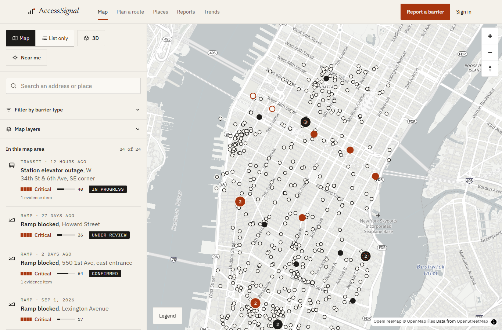
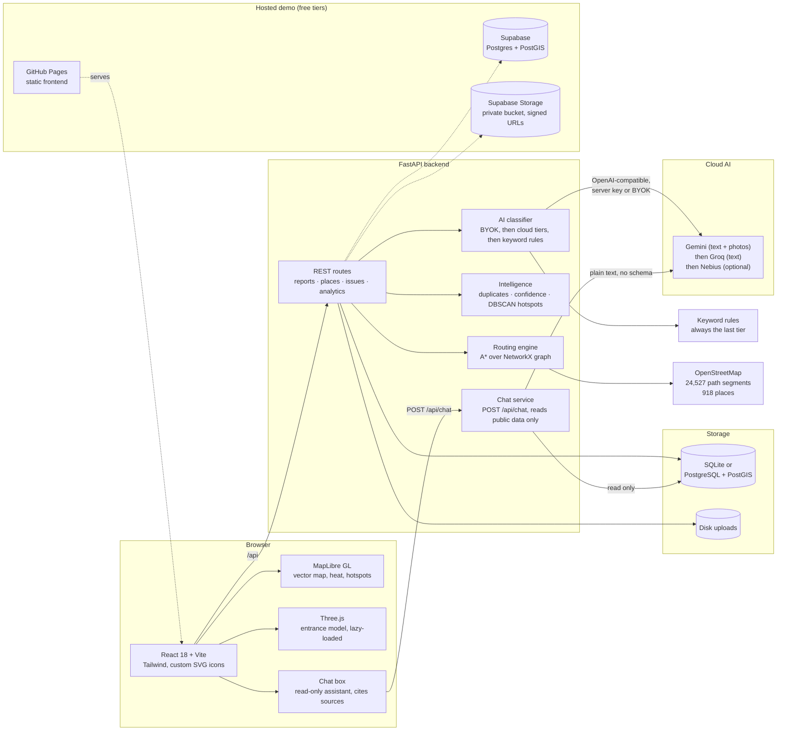

<div align="center">

<br>

# AccessSignal

### Know which ramps, elevators and curb cuts are working before you leave.

Community-reported accessibility conditions for Midtown and Lower Manhattan, checked against each other, scored for confidence, and routed around.

<br>


<br>

[Live demo](docs/DEPLOYMENT.md#judge-quick-demo) · [Quick start](#quick-start) · [Features](#what-it-does) · [Architecture](#architecture) · [Tests](#tests) · [Docs](#documentation)

<br>

</div>

<p align="center">
  
</p>

---

## What it does

AccessSignal is built around one question: *can I get there step-free right now?* Static maps can't answer it, because a ramp that was fine last week can be blocked by a delivery truck this morning.

<table>
<tr>
<td width="50%" valign="top">

### Map of live conditions
Every open barrier on one map, sized and outlined by severity so the level reads without colour. Switch to a list-only view, add a severity heat map, or see hotspots and the blocks where nobody has reported anything.

</td>
<td width="50%" valign="top">

### Routes that avoid barriers
Four travel profiles: wheelchair, reduced effort, low vision and walking. Each route explains what it avoids and what it costs, for example *"Avoids 1 reported barrier … 170 m longer (+36%)"*.

</td>
</tr>
<tr>
<td width="50%" valign="top">

### Reports you can trust
Each report carries a confidence score built from evidence, independent corroboration, recency and reporter history. Every factor shows its reason. Duplicates are detected before they're filed.

</td>
<td width="50%" valign="top">

### Cloud AI, with a read-only assistant
Photos and text are classified by a cloud model: Gemini or Groq on the server's free-tier keys, or your own key from Settings. A read-only assistant answers questions about the report, place or route on screen, and cites the records it used. It can't file, change or verify anything. When no cloud model answers, keyword rules take over, and every result says which one produced it.

</td>
</tr>
<tr>
<td width="50%" valign="top">

### Issues through to repair
Staff work a priority queue through a seven-stage workflow with an audit trail. A fix only closes after someone nearby confirms it. Every status change is recorded with the person who made it.

</td>
<td width="50%" valign="top">

### Built for assistive technology
Keyboard-first, with skip links, focus management, data tables behind every chart and a text equivalent for every map. Automated axe checks pass on the main pages, and no page scrolls sideways down to 320 px.

</td>
</tr>
</table>

## Screenshots

<table>
<tr>
<td width="50%"><br><sub><b>Map.</b> Reports are sized and outlined by severity. Clusters show counts.</sub></td>
<td width="50%"><br><sub><b>Route planner.</b> The wheelchair route avoids a reported missing curb cut.</sub></td>
</tr>
<tr>
<td width="50%"><br><sub><b>Place profile.</b> Each feature shows where its information came from, plus a timeline.</sub></td>
<td width="50%"><br><sub><b>Issue queue.</b> Staff work from the top, ordered by priority, then confidence.</sub></td>
</tr>
</table>

<p align="center"><br><sub><b>Trends.</b> Public weekly figures, median time to repair, and where barriers concentrate.</sub></p>

## Architecture



| Layer | Choice | Why |
|---|---|---|
| Frontend | React 18, TypeScript, Vite, Tailwind | Fast builds, strict types, design tokens in one config |
| Maps | MapLibre GL, OpenFreeMap tiles | Open source, no API key, extruded buildings for 3D |
| 3D | Three.js with React Three Fiber | Used selectively, with a 2D fallback when WebGL is missing |
| Backend | FastAPI, SQLAlchemy 2, Pydantic | Typed endpoints and generated OpenAPI docs |
| Routing | NetworkX A* with per-profile costs | Transparent weights, so every route can explain itself |
| AI | Gemini, Groq and Nebius through one OpenAI-compatible client, with a bring-your-own-key option | Classification uses a schema and the taxonomy; the chat assistant uses plain text and never writes. Keyword rules keep the app working with no key |
| Hosting | GitHub Pages, Render, Supabase (free tiers) | $0 demo. Auth stays in FastAPI; Supabase is Postgres and Storage only. See [DEPLOYMENT.md](docs/DEPLOYMENT.md) |
| Data | OpenStreetMap via Overpass (ODbL) | Real pedestrian network, not a synthetic grid |

## Quick start

**Windows** (PowerShell):

```powershell
.\scripts\setup_dev.ps1      # virtualenv, dependencies, OSM graph if missing, demo data, npm install
```

Then start both servers in separate terminals:

```powershell
cd backend;  .\.venv\Scripts\python.exe -m uvicorn app.main:app --port 8000
cd frontend; npm run dev
```

Open **http://localhost:5173**. On macOS or Linux, run `scripts/setup_dev.sh`.

> If port 5173 is already in use, run `npx vite --port 5180` in `frontend/` and open http://localhost:5180.

<details>
<summary><b>Demo accounts</b> (all use the password <code>Signal-demo-2026</code>)</summary>

<br>

| Account | Role | What to see |
|---|---|---|
| `priya.raman@example.org` | Community member, wheelchair user | Filing reports, routing |
| `dana.whitfield@city.example.org` | Infrastructure manager, DOT liaison | Issue queue and workflow |
| `marcus.oyelaran@city.example.org` | Infrastructure manager, MTA accessibility | Station elevator outage |
| `admin@city.example.org` | Admin | Everything |

The seed data is a five-part Manhattan story: a blocked hospital ramp with three corroborating reports, a subway elevator outage, a missing curb cut at Union Square, a resolved fix at Grand Central awaiting reverification, and an unmapped block on Orchard Street.

Reset at any time:

```powershell
cd backend; .\.venv\Scripts\python.exe -m scripts.seed_demo --reset
```

</details>

<details>
<summary><b>AI keys (optional)</b></summary>

<br>

The app runs without any AI key: suggestions come from keyword rules, labelled *Keyword rules, AI offline*, and the assistant is offline. To turn on cloud models, add a key to `.env` at the repository root:

| Provider | Variable | Get a key | Photos |
|---|---|---|---|
| Google Gemini | `GEMINI_API_KEY` | [Google AI Studio](https://aistudio.google.com/apikey) | Yes |
| Groq | `GROQ_API_KEY` | [GroqCloud console](https://console.groq.com/keys) | No |
| Nebius (optional) | `NEBIUS_API_KEY` | [Nebius Token Factory](https://tokenfactory.nebius.com/project/api-keys) | Only with `NEBIUS_VISION=true` |

Set `AI_PROVIDER=cloud` (the default) and restart the API. The startup log lists which keys it found. Anyone can also paste their own key in **Settings**; it stays in that browser tab and is sent only with AI requests. Details and free-tier limits are in [DEPLOYMENT.md](docs/DEPLOYMENT.md#ai-keys-and-free-tiers).

</details>

<details>
<summary><b>Docker with PostGIS</b></summary>

<br>

```bash
docker compose up --build
docker compose exec backend python -m scripts.seed_demo --reset
```

Then open http://localhost:3000. The Postgres path (Alembic migrations and seeding on `postgis/postgis:16-3.4`) is verified; the compose file as a whole has not been run end to end. See [`PROJECT_STATUS.md`](PROJECT_STATUS.md).

</details>

## Tests

| Suite | Count | Command | Covers |
|---|---:|---|---|
| Backend | 100 | `pytest` | API flows, issue state machine, evidence privacy on disk and Supabase, property-based routing costs (Hypothesis), cloud providers and keyword fallback against a fake OpenAI server, BYOK, the read-only chat (grounding, no writes, limits, key redaction), CORS, deploy config |
| Frontend unit | 47 | `npm test` | Form controls, status marks, password rules, legal pages, route guards, axe checks, demo dataset, cold-start banner and retry, BYOK key handling, the assistant panel (focus, Escape, sources, read-only notice) |
| End-to-end | 31 | `npm run test:e2e` | Filing a report, manager workflow, route avoidance, axe on 9 pages, overflow at desktop, mobile and 390 px. Point `E2E_BASE_URL` at the live site to run it there |

The E2E suite files a real report and edits an issue, so reseed afterwards.

## Documentation

| Document | What's in it |
|---|---|
| [Architecture](docs/ARCHITECTURE.md) | Components, data model, request flow, security decisions |
| [API](docs/API.md) | Endpoint reference and examples. Interactive docs at `/api/docs` |
| [User guide](docs/USER_GUIDE.md) | How to report, route and manage issues |
| [Accessibility audit](docs/ACCESSIBILITY_AUDIT.md) | What's automated, contrast ratios, and what's still manual |
| [Design audit](docs/DESIGN_AUDIT.md) | Checks against the anti-AI design directive |
| [Open source and cost audit](docs/OPEN_SOURCE_AND_COST_AUDIT.md) | Licences for every dependency and service |
| [Hackathon strategy](docs/HACKATHON_STRATEGY.md) | Five-minute demo script |
| [Deployment](docs/DEPLOYMENT.md) | Judge demo script, AI keys and free-tier facts, hosting on Pages + Render + Supabase |
| [Project status](PROJECT_STATUS.md) | Task-by-task status against the plan, and what's unverified |

## Principles

- **Zero running cost.** Nothing needs a key to run. The hosted demo uses free tiers only; anyone can bring their own AI key.
- **Explainable by default.** Every score, route and hotspot shows its reasons.
- **No single channel.** The map always has a list beside it, charts have tables, routes have written directions, and the assistant is an addition to the report form, not a replacement.
- **Human decisions stay human.** The assistant reads and explains; it can't file, change, verify or resolve anything. AI drafts fill a preview that a person must choose to use and send. Staff confirm, assign and resolve.

## Licence

Code is MIT. Map and path data © OpenStreetMap contributors, available under the [Open Database License](https://opendatacommons.org/licenses/odbl/1-0/).

