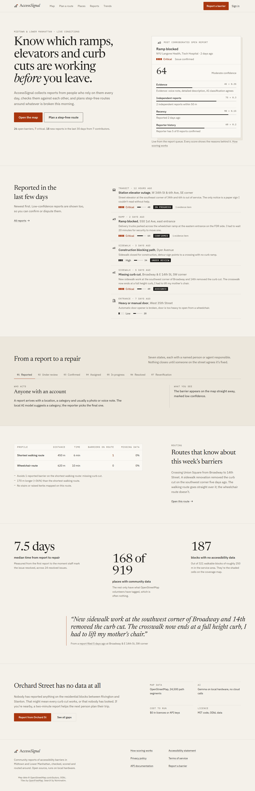
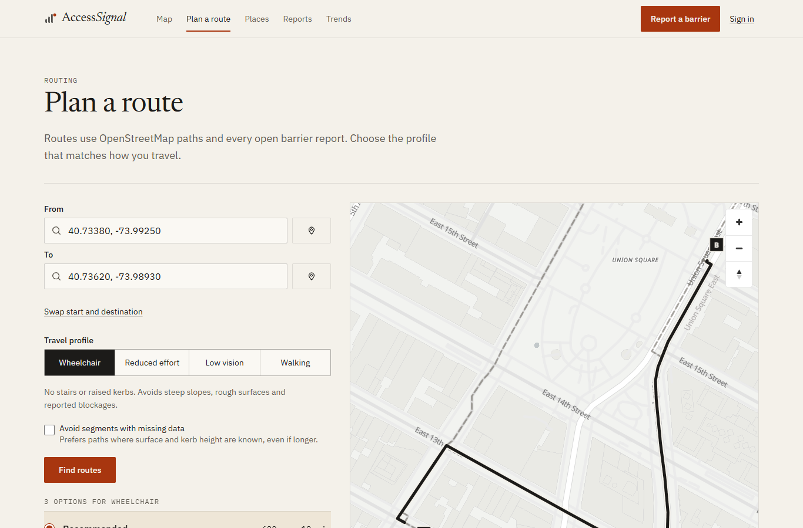
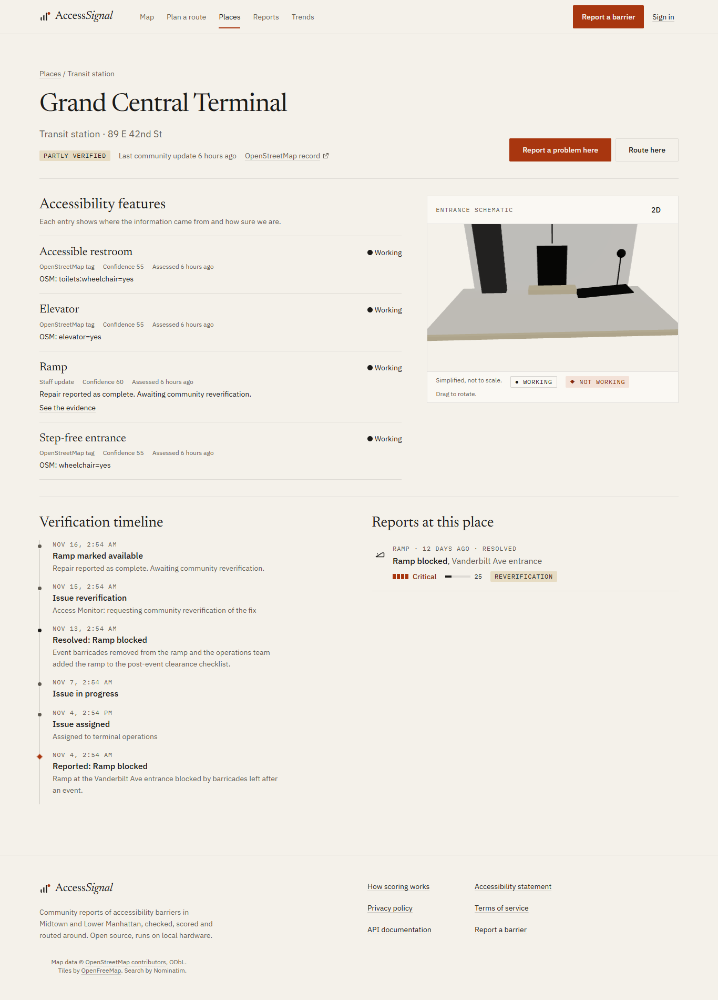
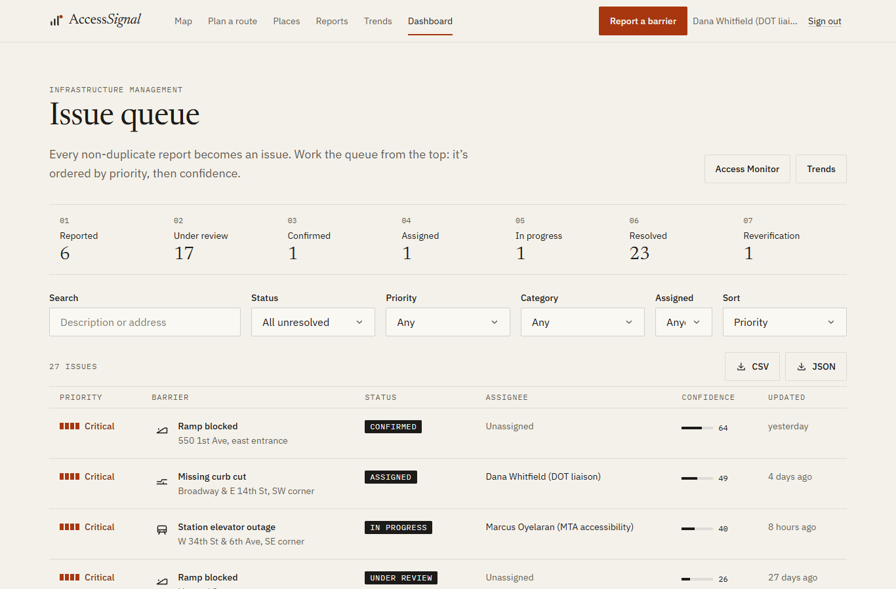
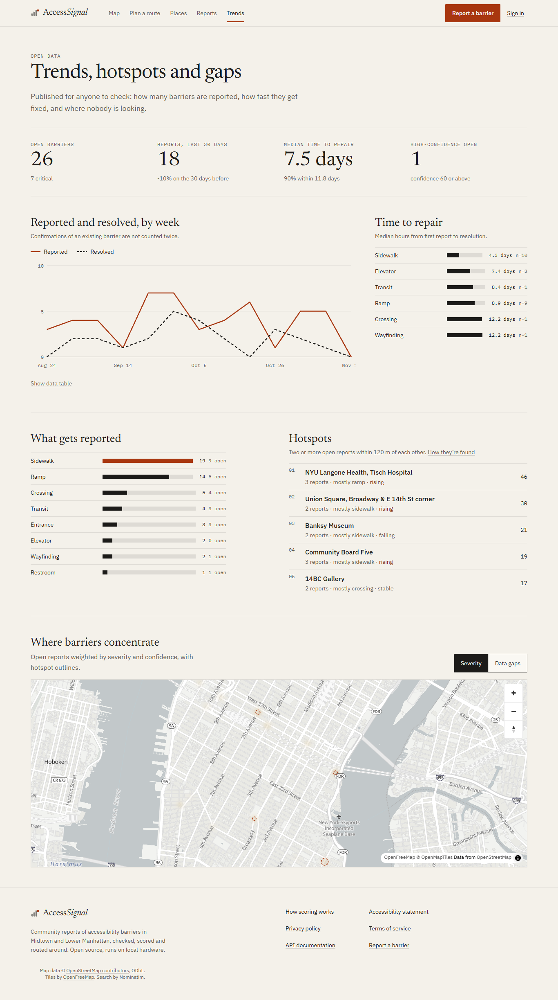
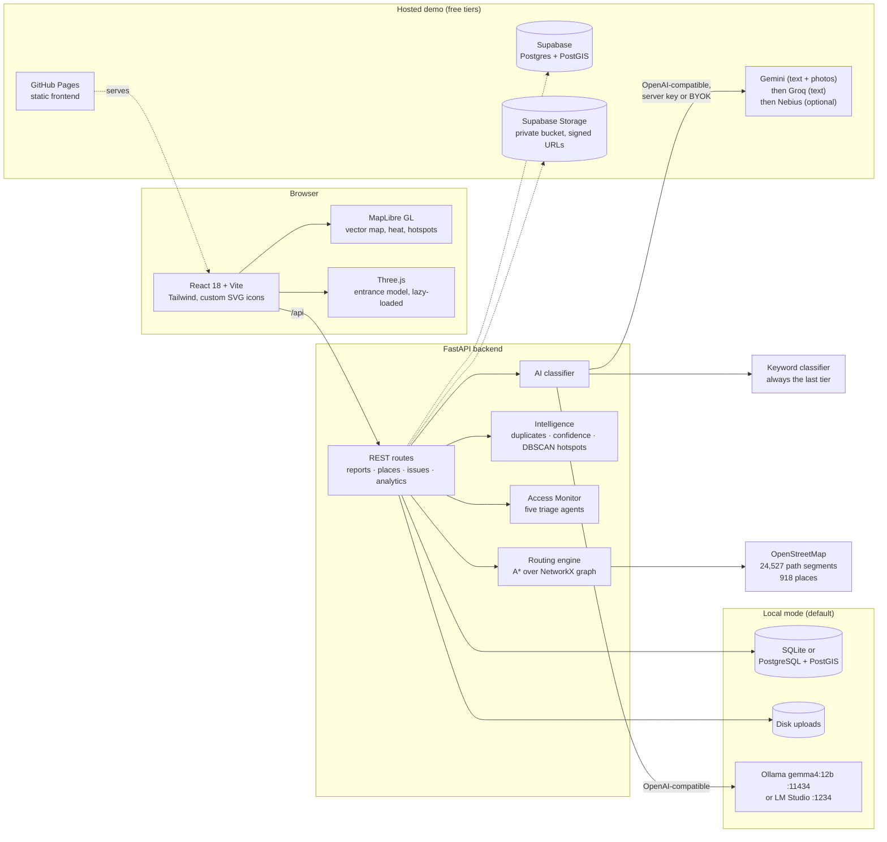

<div align="center">

<br>

# AccessSignal

### Know which ramps, elevators and curb cuts are working before you leave.

Community-reported accessibility conditions for Midtown and Lower Manhattan, checked against each other, scored for confidence, and routed around.

<br>


<br>

[Live demo](docs/DEPLOYMENT.md#judge-quick-demo) · [Quick start](#quick-start) · [Features](#what-it-does) · [Architecture](#architecture) · [Tests](#tests) · [Docs](#documentation)

<br>

</div>

<p align="center">
  
</p>

---

## What it does

AccessSignal is built around one question: *can I get there step-free right now?* Static maps can't answer it, because a ramp that was fine last week can be blocked by a delivery truck this morning.

<table>
<tr>
<td width="50%" valign="top">

### Map of live conditions
Every open barrier on one map, sized and outlined by severity so the level reads without colour. Switch to a list-only view, add a severity heat map, or see hotspots and the blocks where nobody has reported anything.

</td>
<td width="50%" valign="top">

### Routes that avoid barriers
Four travel profiles: wheelchair, reduced effort, low vision and walking. Each route explains what it avoids and what it costs, for example *"Avoids 1 reported barrier … 170 m longer (+36%)"*.

</td>
</tr>
<tr>
<td width="50%" valign="top">

### Reports you can trust
Each report carries a confidence score built from evidence, independent corroboration, recency and reporter history. Every factor shows its reason. Duplicates are detected before they're filed.

</td>
<td width="50%" valign="top">

### Local AI first, free cloud for the demo
Photos and text are classified by Gemma running in Ollama or LM Studio on your own machine. The hosted demo uses free Gemini or Groq tiers instead, and judges can paste their own key. When no model answers, a keyword classifier takes over, and every result says which one produced it.

</td>
</tr>
<tr>
<td width="50%" valign="top">

### Issues through to repair
Staff work a priority queue through a seven-stage workflow with an audit trail. A fix only closes after someone nearby confirms it. Five Access Monitor agents handle first-pass triage, as a dry run unless you allow changes.

</td>
<td width="50%" valign="top">

### Built for assistive technology
Keyboard-first, with skip links, focus management, data tables behind every chart and a text equivalent for every map. Automated axe checks pass on the main pages, and no page scrolls sideways down to 320 px.

</td>
</tr>
</table>

## Screenshots

<table>
<tr>
<td width="50%"><br><sub><b>Map.</b> Reports are sized and outlined by severity. Clusters show counts.</sub></td>
<td width="50%"><br><sub><b>Route planner.</b> The wheelchair route avoids a reported missing curb cut.</sub></td>
</tr>
<tr>
<td width="50%"><br><sub><b>Place profile.</b> Each feature shows where its information came from, plus a timeline.</sub></td>
<td width="50%"><br><sub><b>Issue queue.</b> Staff work from the top, ordered by priority, then confidence.</sub></td>
</tr>
</table>

<p align="center"><br><sub><b>Trends.</b> Public weekly figures, median time to repair, and where barriers concentrate.</sub></p>

## Architecture



| Layer | Choice | Why |
|---|---|---|
| Frontend | React 18, TypeScript, Vite, Tailwind | Fast builds, strict types, design tokens in one config |
| Maps | MapLibre GL, OpenFreeMap tiles | Open source, no API key, extruded buildings for 3D |
| 3D | Three.js with React Three Fiber | Used selectively, with a 2D fallback when WebGL is missing |
| Backend | FastAPI, SQLAlchemy 2, Pydantic | Typed endpoints and generated OpenAPI docs |
| Routing | NetworkX A* with per-profile costs | Transparent weights, so every route can explain itself |
| AI | Ollama or LM Studio locally; Gemini, Groq, Nebius when hosted | One OpenAI-compatible client with one prompt and schema for every tier. Keyword fallback keeps the app working offline |
| Hosting | GitHub Pages, Render, Supabase (free tiers) | $0 demo. Auth stays in FastAPI; Supabase is Postgres and Storage only. See [DEPLOYMENT.md](docs/DEPLOYMENT.md) |
| Data | OpenStreetMap via Overpass (ODbL) | Real pedestrian network, not a synthetic grid |

## Quick start

**Windows** (PowerShell):

```powershell
.\scripts\setup_dev.ps1      # virtualenv, dependencies, OSM graph if missing, demo data, npm install
```

Then start both servers in separate terminals:

```powershell
cd backend;  .\.venv\Scripts\python.exe -m uvicorn app.main:app --port 8000
cd frontend; npm run dev
```

Open **http://localhost:5173**. On macOS or Linux, run `scripts/setup_dev.sh`.

> If port 5173 is already in use, run `npx vite --port 5180` in `frontend/` and open http://localhost:5180.

<details>
<summary><b>Demo accounts</b> (all use the password <code>Signal-demo-2026</code>)</summary>

<br>

| Account | Role | What to see |
|---|---|---|
| `priya.raman@example.org` | Community member, wheelchair user | Filing reports, routing |
| `dana.whitfield@city.example.org` | Infrastructure manager, DOT liaison | Issue queue, workflow, Access Monitor |
| `marcus.oyelaran@city.example.org` | Infrastructure manager, MTA accessibility | Station elevator outage |
| `admin@city.example.org` | Admin | Everything |

The seed data is a five-part Manhattan story: a blocked hospital ramp with three corroborating reports, a subway elevator outage, a missing curb cut at Union Square, a resolved fix at Grand Central awaiting reverification, and an unmapped block on Orchard Street.

Reset at any time:

```powershell
cd backend; .\.venv\Scripts\python.exe -m scripts.seed_demo --reset
```

</details>

<details>
<summary><b>Local AI (optional): Ollama or LM Studio</b></summary>

<br>

Either server works; both speak the OpenAI-compatible API. Pick one with `AI_PROVIDER` in `.env`.

| | Ollama | LM Studio (default) |
|---|---|---|
| Get the model | `ollama pull gemma4:12b` | Load *Gemma 4 12B* and start the local server |
| `.env` | `AI_PROVIDER=ollama` | nothing, or `AI_PROVIDER=lmstudio` |
| Default URL and model | `http://localhost:11434/v1`, `gemma4:12b` | `http://localhost:1234/v1`, `gemma-4-12b-it-qat-gguf` |

Set `AI_API_BASE` / `AI_MODEL` only to override those defaults. At startup the API logs whether the model was found. Until it is, the keyword classifier handles suggestions and the UI labels them *Keyword rules, AI offline*. With Ollama 0.40 and `gemma4:12b` on an RTX 3060, a photo is classified in about 5 seconds. Photo and thinking-mode details are in [DEPLOYMENT.md](docs/DEPLOYMENT.md#self-hoster-quick-start-with-ollama).

</details>

<details>
<summary><b>Docker with PostGIS</b></summary>

<br>

```bash
docker compose up --build
docker compose exec backend python -m scripts.seed_demo --reset
```

Then open http://localhost:3000. The Postgres path (Alembic migrations and seeding on `postgis/postgis:16-3.4`) is verified; the compose file as a whole has not been run end to end. See [`PROJECT_STATUS.md`](PROJECT_STATUS.md).

</details>

## Tests

| Suite | Count | Command | Covers |
|---|---:|---|---|
| Backend | 71 | `pytest` | API flows, issue state machine, evidence privacy on disk and Supabase, property-based routing costs (Hypothesis), every AI provider against a fake OpenAI server, BYOK, CORS, deploy config |
| Frontend unit | 37 | `npm test` | Form controls, status marks, password rules, legal pages, route guards, axe checks, demo dataset, cold-start banner and retry, BYOK key handling |
| End-to-end | 31 | `npm run test:e2e` | Filing a report, manager workflow, route avoidance, axe on 9 pages, overflow at desktop, mobile and 390 px. Point `E2E_BASE_URL` at the live site to run it there |

The E2E suite files a real report and edits an issue, so reseed afterwards.

## Documentation

| Document | What's in it |
|---|---|
| [Architecture](docs/ARCHITECTURE.md) | Components, data model, request flow, security decisions |
| [API](docs/API.md) | Endpoint reference and examples. Interactive docs at `/api/docs` |
| [User guide](docs/USER_GUIDE.md) | How to report, route and manage issues |
| [Accessibility audit](docs/ACCESSIBILITY_AUDIT.md) | What's automated, contrast ratios, and what's still manual |
| [Design audit](docs/DESIGN_AUDIT.md) | Checks against the anti-AI design directive |
| [Access Monitor](docs/ACCESS_MONITOR_AGENT.md) | Agent contracts, permissions and tool definitions |
| [Open source and cost audit](docs/OPEN_SOURCE_AND_COST_AUDIT.md) | Licences for every dependency and service |
| [Hackathon strategy](docs/HACKATHON_STRATEGY.md) | Five-minute demo script |
| [Deployment](docs/DEPLOYMENT.md) | Judge demo script, Ollama quick start, hosting on Pages + Render + Supabase, free-tier facts |
| [Project status](PROJECT_STATUS.md) | Task-by-task status against the plan, and what's unverified |

## Principles

- **Zero running cost.** Local mode needs no keys or accounts. The hosted demo uses free tiers only; judges may bring their own AI key.
- **Explainable by default.** Every score, route and hotspot shows its reasons.
- **No single channel.** The map always has a list beside it, charts have tables, and routes have written directions.
- **Human decisions stay human.** Agents can add notes and move reports into review, but only staff can confirm, assign or resolve.

## Licence

Code is MIT. Map and path data © OpenStreetMap contributors, available under the [Open Database License](https://opendatacommons.org/licenses/odbl/1-0/).

